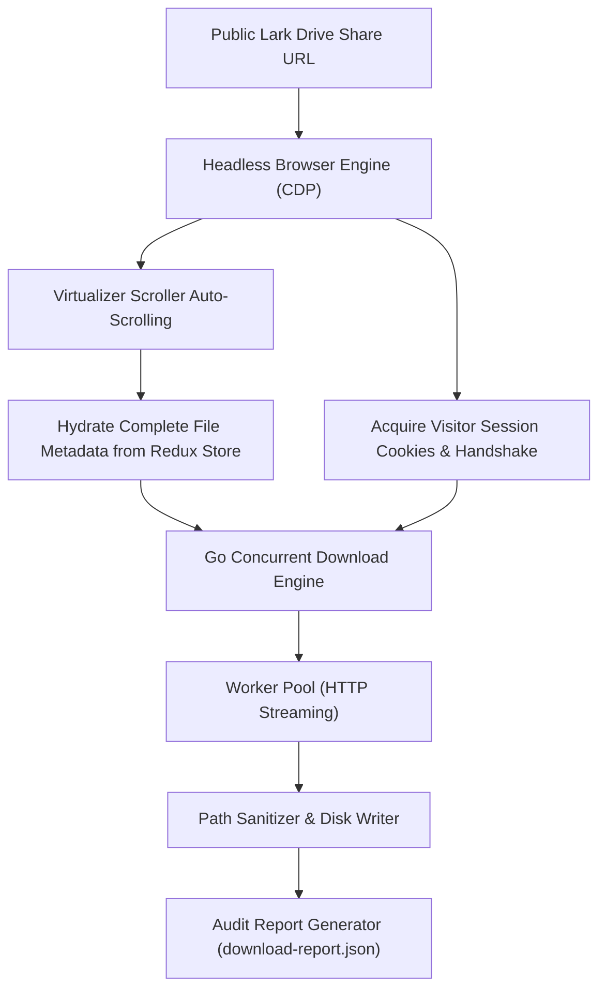

# Lark Drive Bulk Downloader

[](RELEASE.md)
[](https://golang.org)
[](https://github.com)
[](LICENSE)

An enterprise-grade, high-performance command-line utility built in Go for automated, batch downloading of files from public **Lark Drive** and **Feishu Drive** shared folder links to local storage.

---

## 1. Executive Summary & Problem Statement

Publicly shared Lark and Feishu Drive folders present notable constraints for bulk data retrieval:
- **No Native Batch Download**: Public visitor (unauthenticated guest) views do not offer a single-click archive/zip download option for full folder contents.
- **Client-Side Virtualized Rendering**: Lark Drive employs a virtualized scroller (`VirtualizerScroller`). In large folders (e.g., hundreds of media items), only the initial 50 items exist in memory upon page mount; remaining items are loaded lazily during active scrolling.
- **Anti-Bot & Session Protection**: Standard HTTP clients (`curl`, `wget`, or generic scrapers) cannot directly retrieve shared files. Non-browser GET requests are immediately redirected via HTTP 302 to regional authentication gateways (`accounts.larksuite.com/accounts/page/login`) because the backend requires ephemeral visitor tokens, device fingerprinting, and HttpOnly session cookies.

### The Solution: Hybrid Architecture
**Lark Drive Bulk Downloader** couples headless browser automation with a native Go streaming engine:
1. **Headless Discovery & Virtualization Unrolling**: Automatically provisions a transient, headless Chrome/Edge instance via Chrome DevTools Protocol (CDP) to obtain visitor session cookies and trigger incremental auto-scrolling until the complete folder index is loaded into the page store.
2. **Pure Go Concurrent Streaming Engine**: Concurrently streams binary payloads directly to disk through a worker pool, bypassing browser overhead to minimize RAM usage and maximize network bandwidth.

---

## 2. Key Capabilities

- **Automated Infinite Scroll Resolution**: Seamlessly handles Lark's virtualized list scroller, unrolling large folders (100+ files) into complete entity inventories.
- **High-Throughput Parallel Worker Pool**: Configurable worker concurrency (default: 4, configurable up to 64) with per-worker connection pooling.
- **Zero-RAM Disk Streaming**: Data streams directly from HTTP response bodies to local disk files, ensuring minimal memory footprint regardless of file size.
- **Resilient Retry Mechanism**: Implements exponential backoff with full jitter for transient network failures and HTTP 429/5xx status codes, while failing fast on permanent errors (HTTP 401/403/404).
- **Cross-Platform Path Sanitization**: Prevents directory traversal attacks (`../`) and normalizes reserved Windows/POSIX characters (`<>:"/\|?*`).
- **Structured Audit & Telemetry**: Emits a comprehensive `download-report.json` with execution timestamps, byte counts, and per-file transfer statuses.

---

## 3. System Requirements

| Component | Requirement |
|---|---|
| **Operating System** | Windows 10/11, macOS 12+, or modern Linux distributions |
| **Installed Browser** | Google Chrome or Microsoft Edge (standard system install paths detected automatically) |
| **Compiler** | Go 1.21 or higher (only required when building from source) |

---

## 4. Building from Source

### Windows (PowerShell)
```powershell
.\build.ps1
```

Or manually:
```powershell
go mod tidy
go test ./...
go build -ldflags="-s -w" -o lark-downloader.exe ./cmd/lark-downloader
```

### Linux / macOS
```bash
go mod tidy
go test ./...
go build -ldflags="-s -w" -o lark-downloader ./cmd/lark-downloader
```

The resulting binary (`lark-downloader.exe` or `lark-downloader`) is completely self-contained and ready for deployment.

---

## 5. Usage & CLI Reference

### Basic Syntax
```bash
lark-downloader [OPTIONS] <SHARE_URL>
```

### Examples

#### 1. Download an Entire Public Folder
```bash
lark-downloader "https://company.larksuite.com/drive/folder/fldcnExampleFolderToken123"
```

#### 2. Specify a Custom Output Directory
```bash
lark-downloader "https://company.larksuite.com/drive/folder/fldcnExampleFolderToken123" --output "./downloads"
```

#### 3. High-Concurrency Download (8 Workers)
```bash
lark-downloader "https://company.larksuite.com/drive/folder/fldcnExampleFolderToken123" --workers 8
```

#### 4. Custom Retry Threshold for Unstable Connections
```bash
lark-downloader "https://company.larksuite.com/drive/folder/fldcnExampleFolderToken123" --retries 5
```

#### 5. Quiet Mode (Optimized for CI/CD & Headless Environments)
```bash
lark-downloader "https://company.larksuite.com/drive/folder/fldcnExampleFolderToken123" --quiet
```

### Options & Flags

| Flag | Shorthand | Default | Description |
|---|---|---|---|
| `--url` | `-u` | *(positional)* | Public Lark / Feishu Drive folder share URL. |
| `--output` | `-o` | `./output` | Base target output directory. |
| `--workers` | `-w` | `4` | Number of concurrent download workers (range: 1–64). |
| `--retries` | `-r` | `3` | Maximum retry attempts for transient server/network failures. |
| `--timeout` | `-t` | `15m` | Maximum HTTP download timeout per file. |
| `--quiet` | `-q` | `false` | Suppress granular per-file progress logs. |
| `--help` | `-h` | `false` | Display help and usage information. |

---

## 6. Output Structure & Audit Telemetry

Each execution creates an isolated timestamped session directory under `--output` (`YYYYMMDD_HHMMSS`). Name collisions within the same second are resolved with sequential suffixes (`_1`, `_2`).

```text
output/
└── 20261029_211958/
    ├── TEAM-001.jpg
    ├── TEAM-002.jpg
    ├── PRESENTATION.pdf
    └── download-report.json
```

### Audit Report Schema (`download-report.json`)
At the conclusion of each run, a machine-readable JSON report is generated:

```json
{
  "start_time": "2026-10-29T21:19:58.5833242+08:00",
  "end_time": "2026-10-29T21:23:19.1912816+08:00",
  "duration": "3m21s",
  "source_url": "https://company.larksuite.com/drive/folder/fldcnExampleFolderToken123",
  "total_files": 196,
  "success_count": 196,
  "failed_count": 0,
  "total_bytes_downloaded": 953282691,
  "files": [
    {
      "name": "TEAM-001.jpg",
      "path": "TEAM-001.jpg",
      "size": 2151836,
      "status": "success",
      "attempts": 1,
      "bytes_downloaded": 2151836
    }
  ]
}
```

---

## 7. Exit Codes

This utility adheres to standard POSIX process exit conventions for scripting and orchestration:

| Exit Code | Name | Description |
|---|---|---|
| `0` | `ExitSuccess` | Execution completed; all discovered files downloaded successfully. |
| `1` | `ExitDownloadError` | One or more files failed to download after all retry attempts. |
| `2` | `ExitInvalidArgs` | Invalid command-line parameters or configuration. |
| `3` | `ExitSourceError` | Link unreachable, browser unavailable, or authentication rejected by host. |

---

## 8. Technical Architecture



1. **Discovery Phase**: A localized headless Chrome/Edge instance opens the URL with a clean temporary profile. The scroller element is identified via dynamic class matching (`[class*="VirtualizerScroller"]`), and simulated scroll events expand the list until the Redux entity count reaches steady state.
2. **Session Transfer**: Session cookies (`passport_web_did`, `t_beda37`, `QXV0aHpDb250ZXh0`, etc.) and the region-specific API host are extracted into an in-memory session object. The browser process terminates immediately.
3. **Execution Phase**: The pure Go download engine allocates jobs across worker goroutines. Each worker establishes HTTP connections using session credentials, validates MIME headers, and streams responses directly into target file descriptors.
4. **Completion Phase**: Any failed transfers are logged to the audit report, and the application exits with a descriptive exit code.

---

## 9. Security & Compliance

- **No Credential Persistence**: Visitor session cookies exist solely in memory during task execution and are never written to disk or audit logs.
- **Path Traversal Protection**: All remote file names and relative paths undergo strict sanitization via `filepath.Clean` and character filtering, ensuring downloads remain strictly constrained within the designated output directory.
- **Read-Only Operation**: The application strictly reads public share representations without modifying, moving, or deleting remote resources.

---

## 10. Quality Assurance & Verification

The test suite validates CLI argument parsing, path sanitization, HTTP retry policies, download engine error paths, and live end-to-end browser discovery:

```powershell
go test -v ./...
```

All tests pass 100% across core modules:
- `internal/cli`
- `internal/downloader`
- `internal/filesystem`
- `internal/lark`
- `internal/report`

---

## 11. Release Notes & Changelog

Comprehensive release notes, feature breakdowns, and upgrade notes are maintained in [RELEASE.md](RELEASE.md).

- **[v0.0.1 (Initial Release)](RELEASE.md)**: First production GA release featuring hybrid CDP discovery, virtualized infinite scroll unrolling, concurrent Go streaming engine, and structured JSON audit reporting.

---

## License

This project is licensed under the MIT License. See [LICENSE](LICENSE) for details.
